# spine-hero

An agent skill for animating a 2D game hero from one painting, for Claude Code, Codex and Cursor. The painting is cut into parts on a Spine skeleton. A strong coding model writes each move as code on that rig, a script measures every capture, and a second, independent model checks close-ups against a list of every defect a human ever caught. A reference video of the hero gives timing only, an image model paints what the painting never showed (hidden parts, swappable gear, and key drawings for fast blows), and the human's eye decides.

**[Watch the 45-second explainer](docs/explainer.mp4)**, or read it step by step below. The model named at each step is the one the original project used, as an example.

## How it works

### Before: every frame painted

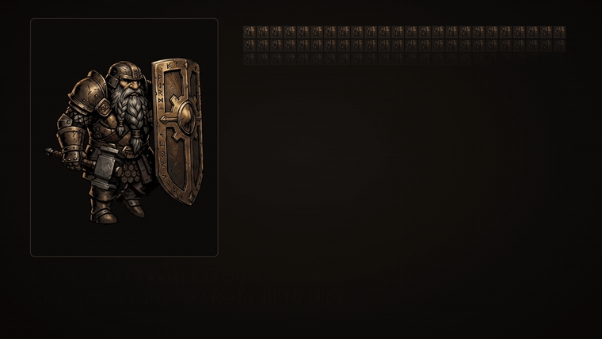

The earlier design of the hero was a flipbook: 10 clips, 403 frames cut from generated videos, with the weapon, shield and armour in every frame. A new weapon meant redoing every clip.

### After: one painting, cut into parts, on a skeleton

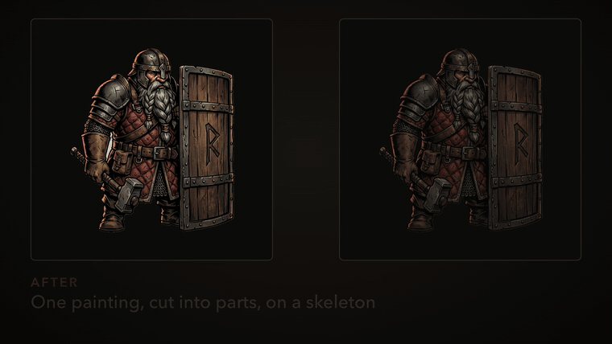

Every clip is then written as code on that rig, never as frames.

### The pipeline

**1. Plan and brief.** The orchestrator writes one brief per move and starts one run per move, so moves are built in parallel.

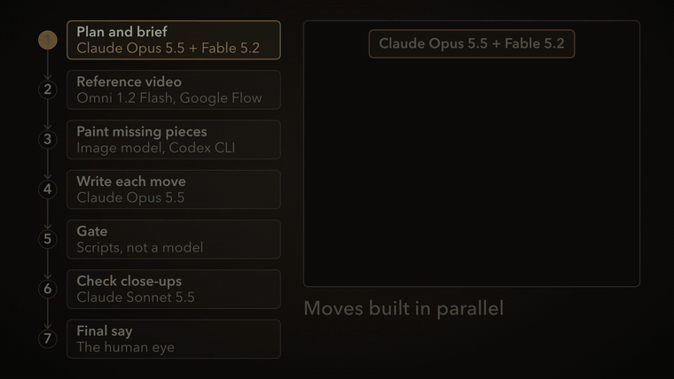

**2. Reference video.** An image-to-video model animates the hero's own painting. It gives timing and beats only; it is never traced or used as frames.

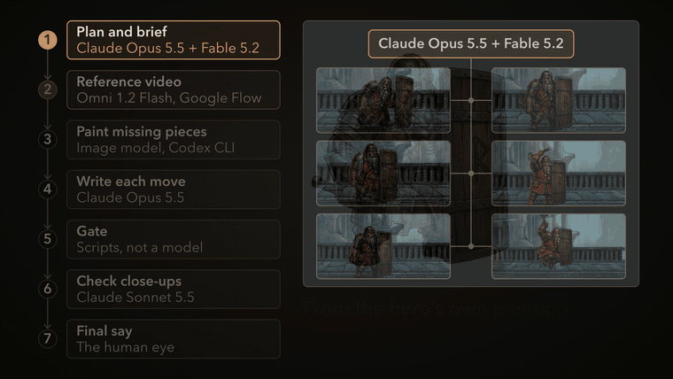

**3. Paint missing pieces.** An image model paints what the painting never showed (a far arm), new gear (an axe, a mace, a tower shield), and key poses for fast blows.

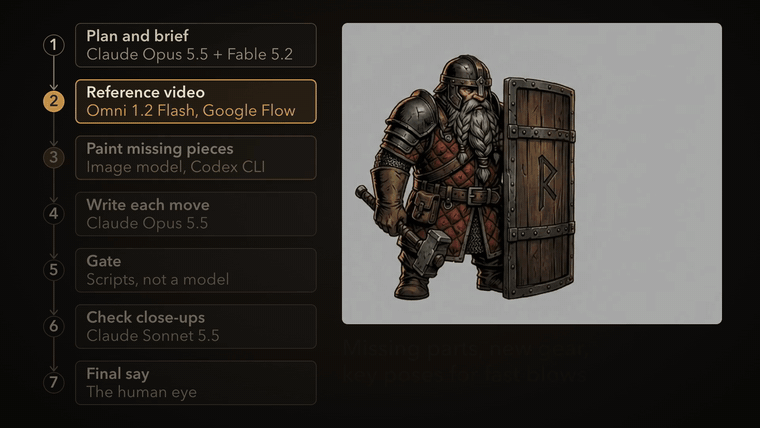

**4. Write each move.** A strong coding model writes the move as keys and IK on the rig, builds it, captures it and looks at its own result.

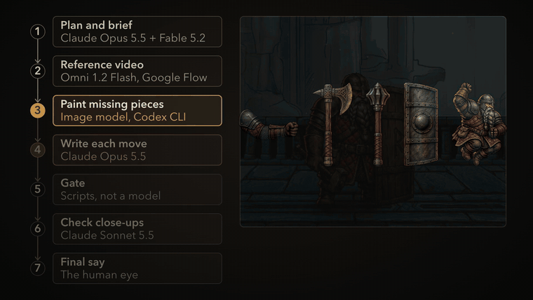

**5. Gate.** A script measures the capture: sliding feet, ground speed, cracks, a move that does not end back at rest, anything drawn outside the hero's box. No model judges the numbers.

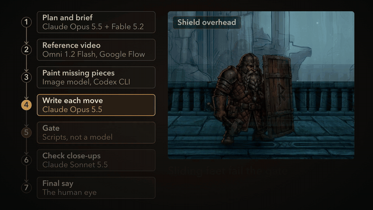

**6. Check close-ups.** An independent model goes through a list of every defect a human ever caught, on 2x close-ups of the feet and the head.

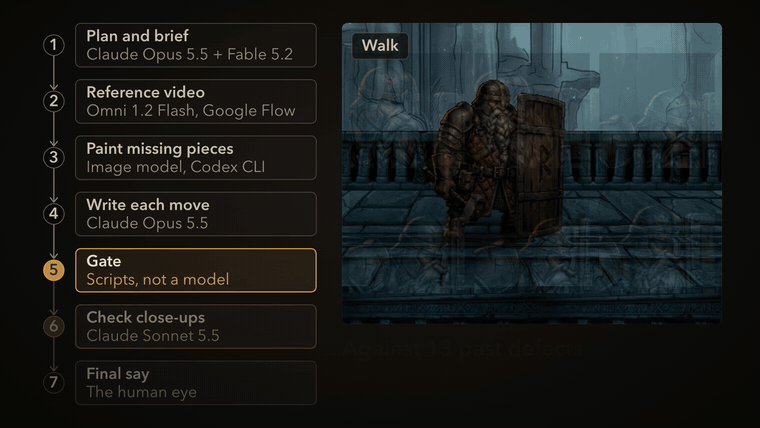

**7. Final say.** A human decides. Each flaw they catch becomes a new line in the defect list or a new gate check.

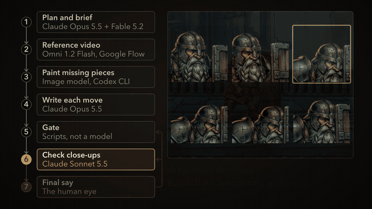

### What comes out

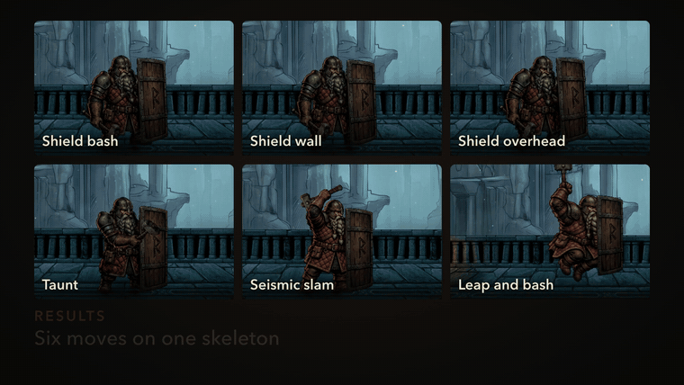

Six moves on one skeleton. Below, the same taunt made the old way and the new way, on two designs of the hero.

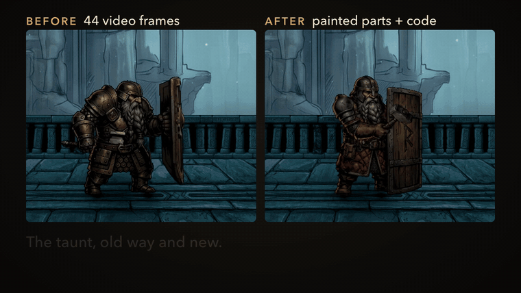

Because the gear rides its own bones, a weapon or a shield can be swapped and every move still plays.

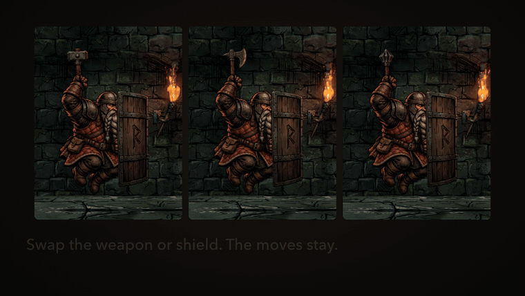

## What is in the repo

```
skills/spine-hero/                the skill: the only copy of the content
  SKILL.md                        the loop and the rules (short; loads when the skill is used)
  references/                     read on demand
    pipeline.md                   roles as tiers: orchestrator, author, gate, review, check, video, image, human
    rig.md                        step 0: from one painting to a rig; conventions; the idle
    locomotion.md                 walk and run lessons
    moves.md                      rig or key drawings (and how to decide), gear on bones, swaps, ranged weapons
    reference-video.md            the timing reference: prompt template, the beats file, no-video path
    defects.md                    13 defects a human caught that the checks missed, and how to see each
    gate.md                       step 0b: the capture contract; every check, its limit and why; first limits
    orchestration.md              briefs, one run per move, the lock, budgets, the ladder, one-agent mode
  scripts/
    gate.mjs                      the deterministic gate (plain Node, no dependencies)
    gate-limits.json              example limits, calibrated on one game
    gate.test.mjs                 its tests: node --test
    with_lock.sh                  run a build-and-gate under a shared lock, for several authors at once
  assets/metrics.example.json     an example of the capture contract
.claude-plugin/                   Claude Code plugin and marketplace manifests (point at skills/)
plugin.json, .agents/plugins/     Codex plugin manifest and repo marketplace (point at skills/)
.cursor-plugin/                   Cursor plugin and marketplace manifests (point at skills/)
AGENTS.md                         a pointer to the skill for any agent working in this repo
docs/                             the explainer video and the step GIFs above
```

## What you must bring

- **One painting of the hero**: finished, side view, at rest.
- **A Spine-style skeletal runtime** with weighted meshes, IK, attachment keys, draw-order keys and linked meshes. The original used Spine 4.2 with the official runtime for PixiJS in a web game.
- **A way to build the rig from the painting**: cut it into parts, fill what each part hides, and write the skeleton. The original did this with its own build scripts, which are not included. [rig.md](skills/spine-hero/references/rig.md) describes the method (step 0). You can also build the rig by hand in the Spine editor.
- **A way to capture frames from your engine**: play a clip step by step, render it unlit and lit, measure it, and write `metrics.json`. Write it before the first clip: nothing can be gated or reviewed without it. The original capture was tied to its own game, so it is not shipped. [references/gate.md](skills/spine-hero/references/gate.md) gives the contract (step 0b).
- **An image-to-video model** for the reference clip, if you have one (the original used Google Flow, Omni 1.2 Flash). Without one, write the beats by hand; [reference-video.md](skills/spine-hero/references/reference-video.md) says how.
- **An image model** that takes the painting as a reference (the original used the Codex CLI's image tool, and Nano Banana 2.1 in Google Flow for one limb sheet).
- **A coding agent**, ideally one that can start sub-agents for the author, review and check roles. The original used Claude Opus 5.5 and Claude Sonnet 5.5, with Claude Fable 5.2 on planning. With one agent, run the roles as separate passes ([orchestration.md](skills/spine-hero/references/orchestration.md)).
- **Node 18 or later** for the gate.

## Install

All three tools read the open Agent Skills format (a folder with a `SKILL.md`). The content lives once, in `skills/spine-hero/`.

### Claude Code

As a plugin (this repo is its own marketplace). In a session:

```
/plugin marketplace add enoch3712/spine-hero-skill
/plugin install spine-hero@spine-hero-skill
```

Or from a shell:

```sh
claude plugin marketplace add enoch3712/spine-hero-skill
claude plugin install spine-hero@spine-hero-skill --scope user
```

Run `/reload-plugins` if a session was already open. A plugin's skill is named `/spine-hero:spine-hero`. `claude plugin validate .` passes on this repo, with warnings about metadata the plugin directory asks for (licence, icon, author).

Or copy the folder (the skill is then `/spine-hero`):

```sh
git clone https://github.com/enoch3712/spine-hero-skill.git
mkdir -p ~/.claude/skills
cp -R spine-hero-skill/skills/spine-hero ~/.claude/skills/        # every project
# or: cp -R spine-hero-skill/skills/spine-hero <project>/.claude/skills/   # one project
```

### Codex

Link the folder where Codex looks for skills (Codex's docs say it follows symlinked skill folders):

```sh
git clone https://github.com/enoch3712/spine-hero-skill.git
mkdir -p ~/.agents/skills
ln -s "$PWD/spine-hero-skill/skills/spine-hero" ~/.agents/skills/spine-hero     # every project
# or link it to <project>/.agents/skills/spine-hero                             # one project
```

Use it with `$spine-hero` or `/skills`, or let Codex pick it from its description.

As a plugin (not tested): the repo has a root `plugin.json` and `.agents/plugins/marketplace.json`. Run `codex plugin marketplace add enoch3712/spine-hero-skill`, then install it from the Plugins Directory in the ChatGPT desktop app. The docs give no command-line install step.

### Cursor

Cursor reads skills from `.cursor/skills/` and `.agents/skills/` in a project, and from `~/.cursor/skills/` and `~/.agents/skills/` for every project. It also reads `.claude/skills/` and `~/.claude/skills/`. So a copy or link made for Claude Code or Codex above already works in Cursor. On its own:

```sh
git clone https://github.com/enoch3712/spine-hero-skill.git
mkdir -p ~/.cursor/skills
cp -R spine-hero-skill/skills/spine-hero ~/.cursor/skills/          # every project
# or: cp -R spine-hero-skill/skills/spine-hero <project>/.cursor/skills/   # one project
```

Type `/` in Agent chat to call it, or let the agent pick it from its description.

As a plugin (not tested): the repo has `.cursor-plugin/plugin.json` and `.cursor-plugin/marketplace.json`. Import the repo under Customize, From GitHub Repository, or as a team marketplace (Dashboard, Plugins & MCPs, Team Marketplaces, Add Marketplace, Import from Repo), then Install.

### What is confirmed and what is not

| | Confirmed in the tool's docs | Not confirmed |
|---|---|---|
| Claude Code | skill folders in `~/.claude/skills/` and `.claude/skills/`; plugin marketplaces from GitHub; `claude plugin validate` passes on this repo (with metadata warnings) | |
| Codex | skill folders in `~/.agents/skills/` and `.agents/skills/`; symlinks followed; `codex plugin marketplace add owner/repo`; a root `plugin.json` with skills in `skills/` | a marketplace entry whose path is the repo root (`"./"`); a command-line plugin install |
| Cursor | skill folders in `.cursor/skills/`, `.agents/skills/`, their home-folder versions, and the `.claude/skills/` folders; plugins with `skills/` and `.cursor-plugin/plugin.json` | copying a folder in as an install method (inferred from the folders it reads); the marketplace file's exact schema; a marketplace entry for a plugin at the repo root (`"./"`) |

## A short example

You have a painted tank hero rigged in your engine, an idle the human has approved, and a capture script that writes `metrics.json`. You want a walk.

1. Ask your agent: *Use the spine-hero skill. Plan the tank hero's walk, starting with the reference video prompt.*
2. The agent fills in the template from `reference-video.md`. You generate the clip, and the agent reads the beats (contacts, passing frames, step time, swing height) into `walk-beats.json`.
3. An author sub-agent writes the walk as keys and IK on the rig, builds it, captures it, and gates it:

   ```
   $ node skills/spine-hero/scripts/gate.mjs out/walk/try1/off/metrics.json --kind walk --limits my-gate-limits.json
   FAIL example-hero walk: 7/8 checks | slidePxMax=3.1 (limit {"max":2})
   ```

4. `locomotion.md` names this one: a heel strike plus a peel on the ground reads as slide at the sole bone. The author lands the foot flat, does the peel in the air, and gates again: `PASS example-hero walk: 8/8 checks`.
5. A mid-tier model reviews `gate.json` and the sheets. Then an independent check goes through `defects.md` on the 2x feet and head close-ups and finds the far boot as bright as the near one (item 5). The author darkens it, and the gate, the review and the check pass.
6. The orchestrator reads the close-ups itself and shows you the video. Anything you catch becomes line 14 of `defects.md`.

To see the gate run on the example now:

```sh
node --test skills/spine-hero/scripts/gate.test.mjs
cp skills/spine-hero/assets/metrics.example.json /tmp/metrics.json
node skills/spine-hero/scripts/gate.mjs /tmp/metrics.json       # PASS example-hero walk: 8/8 checks
```

## Limits

- It was built on one game: side-view painted heroes, a web runtime, Spine 4.2. It has not been tried with other engines or art styles.
- The rig builder and the capture are yours to write, and they are most of the setup work. The only shipped scripts are the gate (with its tests) and a small lock helper. The gate's pixel limits were calibrated at one capture size. [gate.md](skills/spine-hero/references/gate.md) says which limits carry over and how to set the rest for a first hero.
- A human still directs and judges. The checks miss things: the defect list exists because they did. Expect to add your own lines to it.
- Using it costs model tokens: [orchestration.md](skills/spine-hero/references/orchestration.md) lists the budgets the original used, and a rough total for one hero. The video and image models may cost money too.
- The model names are what the original used, not requirements. Any models at the same tiers fit the roles.
- The plugin install routes for Codex and Cursor have not been tested.
